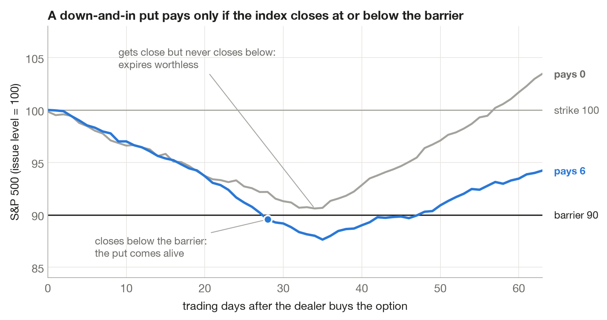
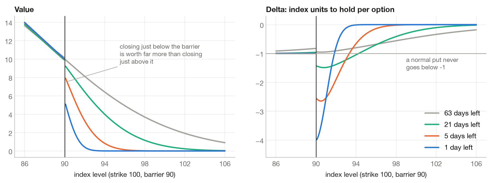
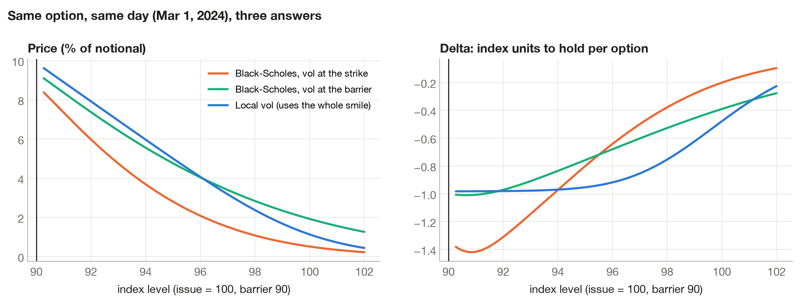
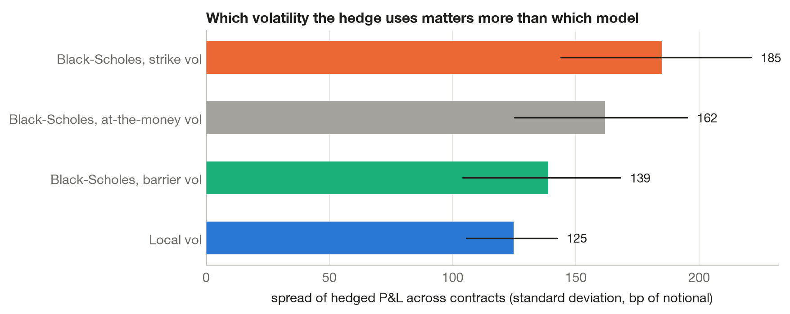
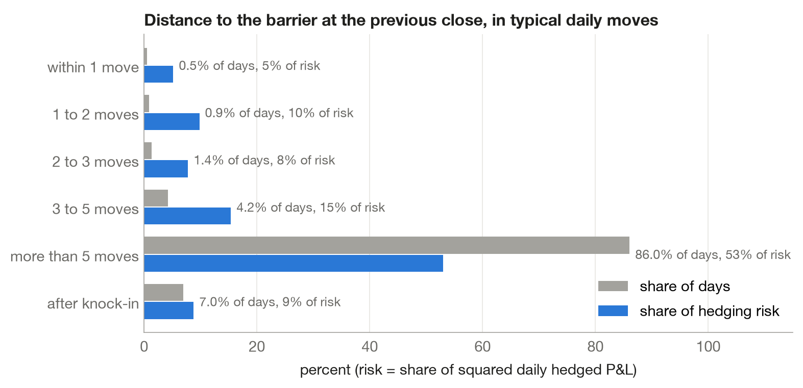
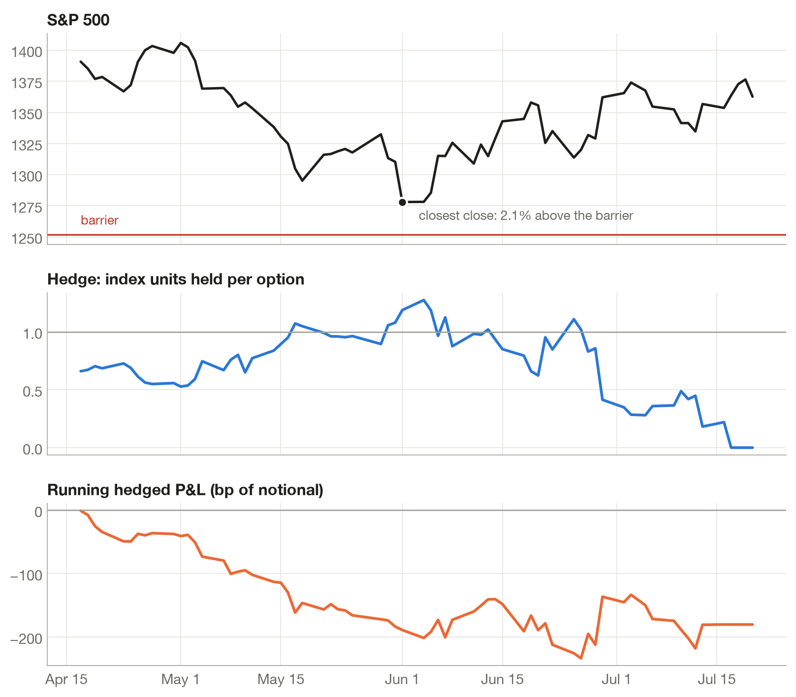
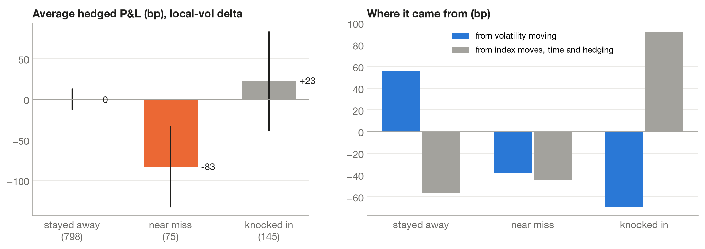
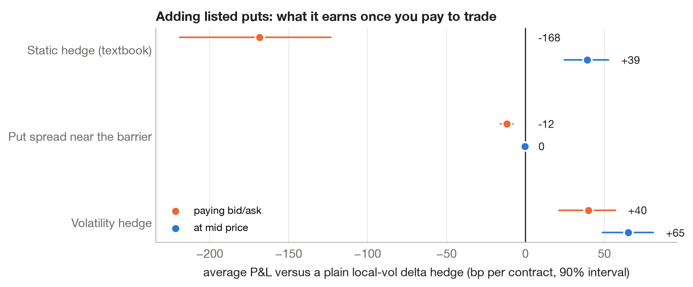
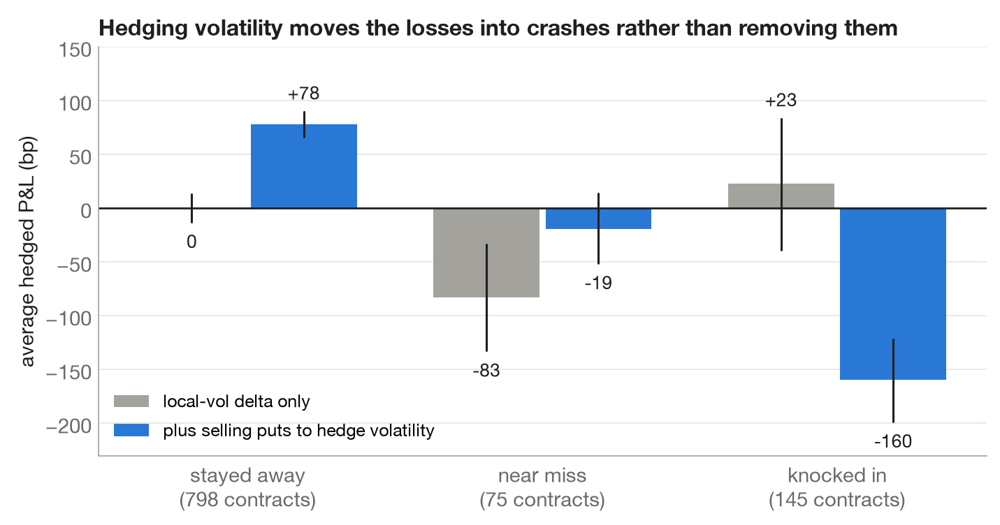

# Hedging a Barrier Option as the Market Falls Toward It

### Twenty years of S&P 500 option data on what works, what doesn't, and where the losses actually come from

**Jack Quinnild** · Carnegie Mellon University · October 2026

---

## Summary

Banks that sell structured notes to investors often end up owning a particular kind of option: a put on the S&P 500 that only comes alive if the index falls to a trigger level, called the barrier. The option is easy to hedge when the market is far from the barrier and hard to hedge when it gets close. I replayed 1,018 of these options, one bought every week from 2005 to 2025, and hedged each one day by day with that day's real option prices and trading costs. I compared seventeen hedging strategies, from plain delta hedging to adding listed options. What I found:

1. **Which volatility you feed the hedge matters more than which model you use.** A Black-Scholes hedge using the volatility at the option's strike left hedged profits that swung 48% more than a hedge built on the full volatility smile. Simply using the volatility at the barrier instead closed most of that gap. *(Section 4.2)*
2. **The risk is concentrated near the barrier.** Days within three typical daily moves of the barrier are 2.8% of the sample but produce 23% of the hedging risk. *(Section 4.3)*
3. **Near misses, not crashes, are where a delta-hedged owner loses money.** Contracts that came within two daily moves of the barrier and bounced off lost 83 basis points of notional on average, about half of it because volatility fell after the scare. Contracts that actually knocked in were roughly break-even. *(Section 4.4)*
4. **The textbook "static" hedge doesn't survive real trading costs.** It needs dozens of option spreads per contract. At mid prices it would have earned 39 basis points more than plain delta hedging; after paying the bid/ask spread it lost 168. *(Section 4.6)*
5. **Hedging volatility moves losses rather than removing them.** Selling puts near the barrier cut near-miss losses from 83 to 19 basis points and added 40 on average, but lost 160 on contracts that knocked in. *(Section 4.7)*

Rules were chosen using contracts issued before 2017 and judged on contracts issued after. The main results hold across five contract designs (barrier at 85, 90 or 95 percent of the starting level; one, three or six months to expiry).

---

## 1. The problem

### The option

A **down-and-in put** is a put option with a condition attached. On the day it's bought, the strike is set at the current index level and a barrier is set below it, here 10% lower. On every trading day until expiry, the closing level is checked against the barrier. If the index ever closes at or below the barrier, the option turns into an ordinary put and pays the usual amount at expiry. If it never does, the option expires worthless, even if the index ended below the strike.

*Figure 1. Two paths of the index. The blue one closes below the barrier, so the put comes alive and pays the gap between the strike and the final level. The grey one comes close but never closes below the barrier, so it pays nothing.*

### Who owns it, and why it's hard to hedge

These options are rarely traded on their own. They sit inside structured notes: an investor buys a note that pays a high coupon but loses money if the market falls through a barrier. Economically, the investor has sold the bank a down-and-in put, so the bank ends up owning the option and has to hedge it. This paper takes the bank's side: **long the barrier put, hedging it**.

A **delta hedge** is the standard way to neutralise an option: hold enough of the index that small market moves leave the combined position unchanged. The number of index units to hold is the option's **delta**. For an ordinary put, delta sits between 0 and −1, so the hedge never needs more than one unit of the index per option.

A barrier put breaks that rule near the barrier. Just before a check, closing a hair below the barrier is worth far more than closing a hair above it, because one makes the option a live put and the other doesn't. That jump makes delta much larger than one near the barrier and very sensitive to small moves, as Figure 2 shows. The hedger has to buy a lot of index as the market falls, then sell it again quickly if the market bounces.

*Figure 2. Value and delta of the option as the index moves, for different amounts of time left (constant 20% volatility). With five days left the hedge calls for about 2.6 units of index per option just above the barrier, far more than any ordinary put would.*

### The question

When the market approaches the barrier, what should the owner of the option do? Keep delta hedging, and if so with which model? Or add listed options to the hedge, which costs money but might handle the jump better? Most published work compares hedges over the whole life of the option. I wanted to look specifically at the approach to the barrier, because that is where the decision is hard, and to test the answers on real prices with real trading costs.

---

## 2. What I compared

Every strategy hedges the same option. They differ in what they believe the right delta is and in whether they also trade listed puts.

**Index-only hedges (which delta to trust)**

| Strategy | How it computes delta |
|---|---|
| Black-Scholes, strike vol | The standard model, using the volatility implied by options struck at the barrier option's strike |
| Black-Scholes, at-the-money vol | Same model, volatility of options struck at the current index level |
| Black-Scholes, barrier vol | Same model, volatility of options struck at the barrier |
| Local vol | A model that lets volatility depend on the index level and time, fitted to the whole set of option prices each day |
| Local vol, barrier shifted | The local-vol delta computed as if the barrier sat half a move or one move closer or further away, a habit some desks use to smooth the hedge |

Volatility needs a word of explanation. Every listed option implies a volatility, the number that makes the standard Black-Scholes formula match its market price. For S&P 500 options, puts with low strikes imply much higher volatility than puts near the current level, because investors pay up for crash protection. That pattern is called the **skew**. A barrier option cares about two places on the skew at once, the strike and the barrier, so a model with a single volatility has to pick one. **Local volatility** avoids the choice by fitting a volatility for every index level and date so that the model reproduces all the listed put prices at once.

**Hedges that add listed puts**

| Strategy | What it trades |
|---|---|
| Static hedge | The textbook replication (Carr, Ellis and Gupta, 1998): sell a fixed portfolio of puts on day one that mirrors the barrier option if the skew were symmetric. Hold it, and buy it back if the barrier is hit. |
| Put spread near the barrier | Delta hedge normally, but when the index comes within 1, 2, 3 or 5 daily moves of the barrier, sell a narrow put spread around the barrier sized to the jump, and buy it back on a retreat. |
| Volatility hedge | Delta hedge, plus sell puts struck at the barrier so the position barely changes value when volatility moves. Resize only when the position drifts more than 25% from target. |

The three option strategies were also run at mid prices, with no bid/ask cost, to separate the idea from the cost of executing it.

---

## 3. How the test works

**Data.** End-of-day S&P 500 option quotes (bid, ask, implied volatility, delta) from OptionMetrics for 2005 to mid-2025, plus the index close, the zero-coupon rate curve and the index dividend yield.

**Contracts.** Every fifth trading day I issue a new hypothetical contract: strike at that day's close, barrier 10% below, expiry on the standard monthly options expiry closest to three months away. That gives 1,018 contracts, 145 of which knocked in. Matching listed expiries means real options with exactly the same expiry are available as hedges.

**Every day of every contract:**

1. Fit the day's volatility surface. For each listed expiry I fit a smooth curve (SVI, a standard five-number shape for the skew) to the put quotes, then convert the surface into local volatility with Dupire's formula.
2. Price the barrier option on a grid of index levels with a finite-difference method, the continuous-time version of the binomial tree I studied in 21-270 and continue to study in 21-370 at CMU. The barrier is checked only at each daily close, as in the contract. This price is also the option's daily mark, since barrier options have no public quotes.
3. Each strategy decides its position using only information available at that close.
4. Trade. The index costs 1 basis point to trade. Listed puts are bought at the ask and sold at the bid, using that day's quotes.
5. Book it. A ledger tracks cash, interest, dividends and positions and produces each day's profit or loss.

**Units.** Profit and loss is measured in **basis points of notional**: hundredths of a percent of the contract's size at issue. A contract on $10 million of the index that loses 83 basis points loses $83,000.

**Measuring a hedge.** A perfect hedge would make the same small amount on every contract. So the main yardstick is how much hedged P&L varies from contract to contract (its standard deviation). Alongside it I report the average P&L and the tail: the mean of the worst 5% of contracts.

**Keeping it honest.**

- Rules that have a setting to choose, such as how close to the barrier the put spread kicks in, were chosen on contracts issued in 2005–2016 and judged on 2017–2025.
- Contracts that came close and bounced are included, not only the ones that knocked in.
- Because a new contract starts every week and each lasts three months, neighbouring contracts share most of their history. Confidence intervals therefore come from resampling whole calendar quarters (a block bootstrap), which gives honestly wider ranges than treating 1,018 contracts as independent.

**Checking the machinery.** The pricing engine matches the closed-form barrier price to nine decimal places (checked against QuantLib), matches a binomial tree, and agrees with a Monte Carlo simulation under the same local volatility. The fitted surfaces reprice listed puts within about 0.1 volatility points on a calm day and within 1 point in the middle of the 2008 and 2020 crashes. In a simulated world where local volatility is the true model, the local-vol hedge leaves less than half the risk of the Black-Scholes hedge (95 versus 224 basis points), confirming that the hedging and bookkeeping code rewards the right model when there is one. A test on a made-up market with constant volatility confirms the unhedged P&L equals the payoff minus the financed premium to the ninth decimal.

---

## 4. Results

### 4.1 The same option, priced three ways, on one day

*Figure 3. One contract on March 1, 2024. Black-Scholes at the strike's volatility prices it at 0.5% of notional, Black-Scholes at the barrier's volatility at 1.9%, and local volatility at 1.1%. Near the barrier, the strike-vol hedge holds 1.4 units of index per option and local vol holds about 1.*

The strike's implied volatility that day was 11.9% and the barrier's was 17.7%. A barrier option lives in both places, so no single number is right, and the hedge ratios disagree most exactly where it matters.

### 4.2 Which delta to trust

*Figure 4. Spread (standard deviation) of hedged P&L across 1,018 contracts, with 90% intervals.*

| Hedge | Average P&L (bp) | Spread of P&L (bp) | Worst 5% average (bp) |
|---|---|---|---|
| No hedge | −133 | 495 | −702 |
| Black-Scholes, strike vol | −40 | 185 | −241 |
| Black-Scholes, at-the-money vol | −44 | 162 | −241 |
| Black-Scholes, barrier vol | −22 | 139 | −271 |
| Local vol | −3 | 125 | −274 |

Local volatility gave the steadiest results: its spread is 0.68 times that of Black-Scholes at the strike's volatility (90% interval 0.57 to 0.81), and 0.57 times on the out-of-sample years 2017–2025 (0.42 to 0.80). Against Black-Scholes at the barrier's volatility the ratio is 0.90 (0.82 to 1.04), which is not statistically different from one.

So most of the benefit comes from using the volatility at the barrier, where the risk sits, rather than from the more elaborate model. That is useful for a desk: a hedger committed to Black-Scholes gets most of the improvement by changing one input.

The improvement isn't uniform. Year by year, local vol beat strike-vol Black-Scholes in 11 of 21 years. It won big in stressed years (2018: spread 71 versus 369; 2015: 142 versus 288) and lost in calm ones (2023: 110 versus 35), so the pooled result reflects avoiding large failures more than winning every year.

Shifting the barrier for hedging purposes did not help. Moving it half a move or a whole move closer made no measurable difference, and moving it further away made results slightly worse.

### 4.3 Where the risk comes from

*Figure 5. Each day's hedged P&L, grouped by how far the index was from the barrier at the previous close, measured in typical daily moves (the at-the-money implied volatility scaled to one day). "Risk" is each group's share of total squared daily P&L.*

Days within three daily moves of the barrier make up 2.8% of all contract-days and 23% of the risk. Days within one move are 0.5% of the sample and 5% of the risk: about ten times their share.

### 4.4 Near misses are the loss

Start with one contract. It was issued on April 17, 2012 with the index at 1,390 and the barrier at 1,251. During the euro-area scare in May the index fell to within 2.1% of the barrier, and the hedge grew past one unit of index per option. The market then recovered and the barrier was never touched. The contract lost 180 basis points.

*Figure 6. One near miss. Top: the index and the barrier. Middle: index units held as a hedge. Bottom: running hedged P&L.*

That pattern is typical. Grouping all contracts by what eventually happened to them:

| What happened | Contracts | Average P&L, local-vol hedge (bp) |
|---|---|---|
| Stayed away from the barrier | 798 | 0 (−12 to 13) |
| Near miss: within two daily moves, never knocked in | 75 | −83 (−132 to −33) |
| Knocked in | 145 | +23 (−39 to 83) |

*Figure 7. Left: average hedged P&L with the local-vol hedge, by outcome, with 90% intervals. Right: how much of each group's P&L came from changes in volatility versus everything else.*

These groups use hindsight, so they describe outcomes rather than a rule anyone could trade on. They show that the expensive episodes for the option's owner aren't the crashes, which the option pays for, but the scares that fade.

The right panel splits each contract's P&L by cause. Each day I compare the option's value with what yesterday's model would have said at today's index level; the difference is the effect of the volatility surface moving. For near misses, volatility accounts for about −38 basis points and index moves, the passage of time and the hedge itself for about −44, so roughly half the loss is volatility falling after the scare.

### 4.5 Many knock-ins can't be hedged by trading the index

Of the 145 contracts that knocked in, 48% were within one daily move of the barrier the day before, 24% were one to two moves away, and 27% were more than two moves away and crossed in a single day. 15% opened below the barrier, meaning the index gapped through overnight and no trading during market hours could have stepped in.

### 4.6 Adding listed puts: the idea versus the cost

*Figure 8. Average P&L of each option strategy minus the plain local-vol hedge, paying the bid/ask spread (orange) and at mid prices (blue), with 90% intervals.*

**The static hedge** loses 168 basis points per contract relative to delta hedging once trading costs are paid. At mid prices it would have earned 39 more. The difference is cost: copying the jump at the barrier requires a narrow put spread with a large quantity, roughly two times the gap between strike and barrier divided by the spread width, which with a spread about 1% wide means dozens of spreads per contract. They are paid for twice, once when sold and again, often in a crisis, when bought back. The positive result at mid prices comes from selling S&P 500 puts, which investors have historically overpaid for.

**The put spread near the barrier** reduced near-barrier daily risk by 13% in the years used to choose it (entry within three daily moves), but by only 3% in the test years (90% interval 0 to 6%). At the contract level it changed the spread of results by about 1% and cost 4 to 17 basis points. It did not survive.

### 4.7 Hedging volatility moves losses rather than removing them

*Figure 9. Average hedged P&L by outcome, with and without the volatility hedge (paying bid/ask).*

Since near-miss losses are partly about volatility, the natural next step was to hedge volatility too, by selling puts struck at the barrier. It worked where intended: near-miss losses fell from 83 to 19 basis points. Contracts that stayed away earned 78 instead of 0, because selling puts collects the premium investors pay for protection. But contracts that knocked in lost 160 instead of making 23, because the sold puts rise in value exactly when the market falls through the barrier.

Overall, the volatility hedge earned 40 basis points per contract more than plain delta hedging (90% interval 21 to 57; 44 on the test years, 13 to 75), with about the same spread of results (ratio 1.04) and a worse bad tail (worst 5% average −324 versus −274). It doesn't reduce risk. It swaps near-miss risk for crash risk and gets paid for doing so.

### 4.8 Do the results hold up?

I reran the whole study four more times: with the barrier at 85% and 95% of the starting level, and with contracts of about one month and six months.

| | Barrier 90%, 3 months | Barrier 85% | Barrier 95% | 1 month | 6 months |
|---|---|---|---|---|---|
| Contracts (knocked in) | 1,018 (145) | 1,018 (67) | 1,018 (332) | 832 (45) | 1,007 (241) |
| Spread ratio, local vol ÷ Black-Scholes at strike vol | 0.68 | 0.43 | 0.93* | 0.75 | 0.83 |
| Spread ratio, local vol ÷ Black-Scholes at barrier vol | 0.90* | 0.94* | 0.88* | 0.98* | 0.91* |
| Days within 3 daily moves of the barrier: share of days, share of risk | 2.8%, 23% | 1.1%, 28% | 6.9%, 26% | 3.1%, 62% | 2.0%, 11% |
| Average near-miss P&L, local-vol hedge (bp) | −83 | −70 | −34 | −76 | −60 |
| Static hedge minus delta hedge, paying bid/ask (bp) | −168 | −191 | −117 | −137 | −195 |
| Static hedge minus delta hedge, at mid (bp) | +39 | +36 | +31 | +10 | +55 |
| Volatility hedge minus delta hedge (bp) | +40 | +27 | +35 | +23 | +51 |

*\* 90% interval includes 1, so not statistically different.*

Every pattern repeats. Using the barrier's volatility gets Black-Scholes within a statistically insignificant distance of local volatility in all five designs. Near misses lose money in all five, the static hedge loses after costs and gains at mid in all five, and the volatility hedge adds 23 to 51 basis points in all five. With the barrier only 5% below the strike, the strike's and the barrier's volatilities are close, so the gap between strike-vol Black-Scholes and local vol shrinks and is no longer significant.

Two more checks. Raising the index trading cost from 1 to 5 basis points leaves the comparisons essentially unchanged (local vol versus strike-vol Black-Scholes: 0.71 instead of 0.68). Dropping every contract alive during the 2008 crisis or the 2020 crash keeps local vol well ahead of strike-vol Black-Scholes (0.63), but Black-Scholes at the barrier's volatility then does as well as local vol (ratio 1.05, interval 0.98 to 1.13). The full model's extra edge comes from the worst periods.

---

## 5. What a desk could take from this

1. **Fix the volatility input before anything else.** A Black-Scholes hedge using the strike's volatility is the worst of the index-only hedges tested. Using the volatility at the barrier gets most of the way to a full local-volatility hedge.
2. **Watch the near misses.** The losses for an owner of these options come from approaches to the barrier that fade, and about half of that is volatility falling after the scare. Risk limits and reserves keyed only to how much a knock-in would cost miss the more frequent problem.
3. **Price execution before choosing a static hedge.** Replication ideas that look clean on paper can be dominated by the cost of trading many narrow spreads.
4. **Selling volatility near the barrier is a trade, not a hedge.** It improves the average and the near misses, and pays for it in crashes.

---

## 6. Limits

- The barrier options are hypothetical. They have no market quotes, so their daily value comes from the local-volatility model, and the price paid on day one is that model's value. The hedging results are compared across strategies that share the same mark, so this mostly cancels in the comparisons, but it matters for the average P&L figures.
- Local volatility has known weaknesses in how it expects the skew to move when the index moves. The split of near-miss losses into "volatility" and "other" depends on that model and should be read as approximate.
- Trades happen at the close using that close's information. Standard monthly S&P 500 options actually settle on the following morning's opening prices; I treat them as settling at the close.
- Option strategies hold listed strikes chosen when the position is opened. On the rare day one isn't quoted (one check in 46,000), it is valued by interpolating between neighbouring strikes.
- One strike level (100% of the starting index) was tested. Barrier level and time to expiry were varied; strike was not.
- Several strategies and settings were compared on the same data. The confidence intervals are not adjusted for that.

---

## 7. Related work

The closed-form price of a continuously monitored barrier option is due to Reiner and Rubinstein (1991). Broadie, Glasserman and Kou (1997) showed how a barrier checked once a day behaves like a continuous barrier shifted away from the index, which is used here as a check on the pricing engine. Static replication of barrier options was developed by Derman, Ergener and Kani (1995) and by Carr, Ellis and Gupta (1998). Engelmann, Fengler, Nalholm and Schwendner (2006) compared static and dynamic hedges for barrier options on DAX data, and Nalholm and Poulsen (2006) studied how model risk affects static hedges. Hull and White (2017) showed that adjusting Black-Scholes delta for how volatility moves with the index improves hedging of ordinary options. Local volatility comes from Dupire (1994), and the SVI curve from Gatheral (2004).

What this study adds is a focus on the approach to the barrier rather than the option's whole life, the dealer's long side, daily rather than continuous barrier checks, real bid/ask on every option trade, and twenty years of out-of-sample-tested S&P 500 history that includes 2008, 2020, 2022 and 2025.

---

## Acknowledgements

I first came across barrier options in a derivatives course at the London School of Economics and wanted to understand what actually happens to the people who have to hedge them. I developed the idea and worked through it with mentors in Carnegie Mellon's Sales and Trading Academy, whose questions shaped the study. Option data are from OptionMetrics via Wharton Research Data Services. Any errors are mine.

---

## References

- Broadie, M., Glasserman, P. and Kou, S. (1997). A continuity correction for discrete barrier options. *Mathematical Finance* 7(4).
- Carr, P., Ellis, K. and Gupta, V. (1998). Static hedging of exotic options. *Journal of Finance* 53(3).
- Derman, E., Ergener, D. and Kani, I. (1995). Static options replication. *Journal of Derivatives* 2(4).
- Dupire, B. (1994). Pricing with a smile. *Risk* 7(1).
- Engelmann, B., Fengler, M., Nalholm, M. and Schwendner, P. (2006). Static versus dynamic hedges: an empirical comparison for barrier options. *Review of Derivatives Research* 9.
- Gatheral, J. (2004). A parsimonious arbitrage-free implied volatility parameterization. Presentation, Global Derivatives.
- Gatheral, J. (2006). *The Volatility Surface*. Wiley.
- Hull, J. and White, A. (2017). Optimal delta hedging for options. *Journal of Banking and Finance* 82.
- Nalholm, M. and Poulsen, R. (2006). Static hedging and model risk for barrier options. *Journal of Futures Markets* 26(5).
- Reiner, E. and Rubinstein, M. (1991). Breaking down the barriers. *Risk* 4(8).
